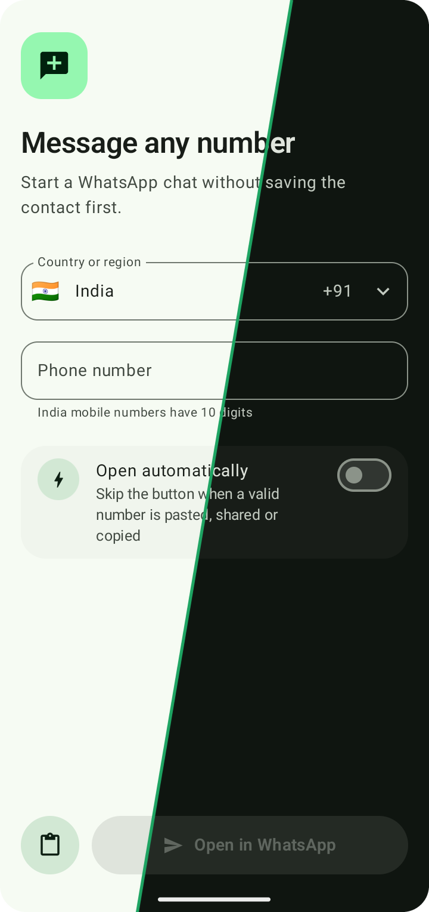
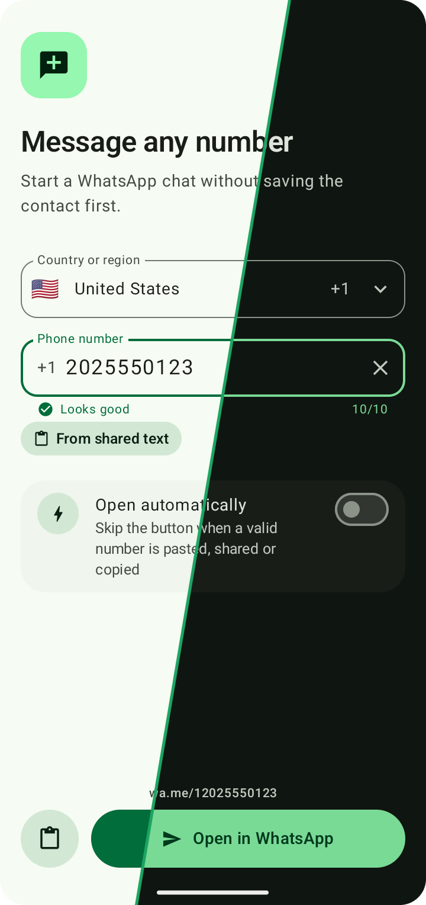
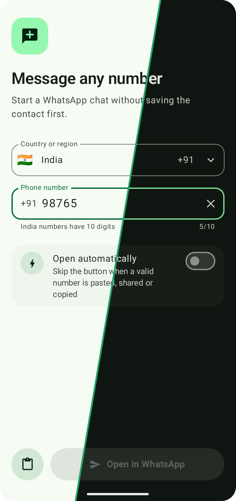
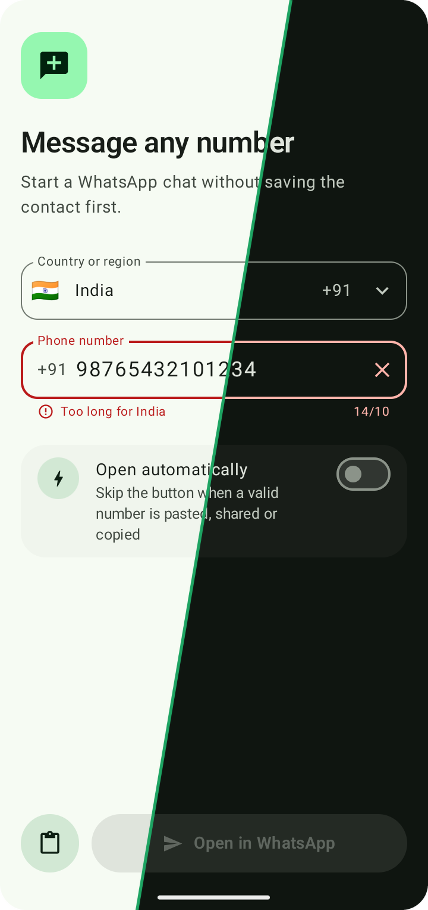
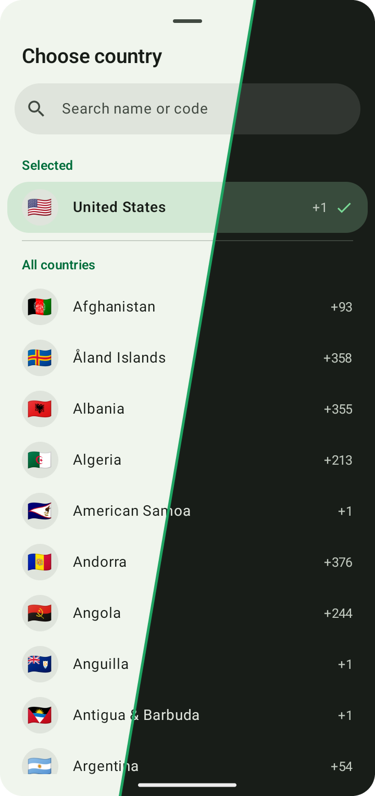
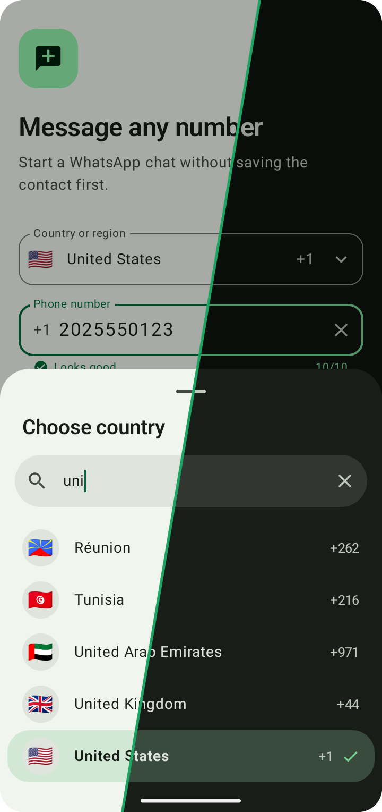

<p align="center">
  
</p>

<h1 align="center">WhatsApp Chat with Unsaved Numbers</h1>

An Android app that opens a WhatsApp chat with any phone number, without saving it as a contact first.

Normally you would have to open a browser, type `https://wa.me/<countrycode><number>` and get the format exactly right. This app does that for you: enter, paste or share a number and tap one button.

<table>
  <tr>
    <td align="center" width="33%"><br><sub>Home screen</sub></td>
    <td align="center" width="33%"><br><sub>Country detected from the number</sub></td>
    <td align="center" width="33%"><br><sub>Digit counter while typing</sub></td>
  </tr>
  <tr>
    <td align="center" width="33%"><br><sub>Too many digits</sub></td>
    <td align="center" width="33%"><br><sub>Country picker</sub></td>
    <td align="center" width="33%"><br><sub>Search by name or code</sub></td>
  </tr>
</table>

Each image shows the light theme on the left and the dark theme on the right. Full versions are in [`light`](docs/screenshots/light) and [`dark`](docs/screenshots/dark). The numbers shown are examples, not real contacts.

## Features

- **Automatic country detection:** paste `+44 7400 123456` and the app selects United Kingdom and leaves `7400123456` in the field.
- **Clipboard check on open:** if the current clipboard entry is a valid phone number, it is filled in for you. Only the current entry is read, not any clipboard history.
- **Validation per country:** the digit count is checked against each country's own rules, so India expects 10 digits and Singapore expects 8.
- **Opens in the WhatsApp app:** it goes to WhatsApp, then WhatsApp Business, and uses the browser only if neither is installed.
- **Share and text selection:** share a number from any app, or select one and choose **Chat on Whatsapp** from the selection menu.
- **Open automatically (optional):** skip the button when a valid number is pasted, shared or copied. It is off by default.
- **Searchable country list:** search by country name or calling code.
- **Light and dark themes:** the app follows your system setting.

## How to use

1. Open the app. India is selected by default, and the app remembers the last country you used.
2. Add a number in any of these ways:
   - Copy it first, then open the app.
   - Paste it into the field, or tap the clipboard button.
   - Type it, choosing the country if needed.
   - Share or select it in another app and choose this one.
3. Tap **Open in WhatsApp**.

### Accepted number formats

| You enter | Selected country | Field shows | Opens |
| --- | --- | --- | --- |
| `+91 98765 43210` | India | `9876543210` | `wa.me/919876543210` |
| `0044 7400 123456` | United Kingdom | `7400123456` | `wa.me/447400123456` |
| `919876543210` | India | `9876543210` | `wa.me/919876543210` |
| `098765 43210` (India selected) | India | `9876543210` | `wa.me/919876543210` |
| `https://wa.me/919876543210` | India | `9876543210` | `wa.me/919876543210` |
| `Call me at +1 650-253-0000` | United States | `6502530000` | `wa.me/16502530000` |

Text from the clipboard is only used if it contains a fully valid number, so things like one-time codes are ignored. A number with the right length that looks unusual for its country can still be opened, with a warning, because phone number data can lag behind newly issued ranges.

## Installation

**[Download the latest APK](https://github.com/chaitanyakelkar/whatsapp-chat-with-unsaved-numbers/releases/latest/download/WhatsappChatOpen.apk)** for Android 7.0 or newer. Older versions are on the [releases page](https://github.com/chaitanyakelkar/whatsapp-chat-with-unsaved-numbers/releases). You also need WhatsApp or WhatsApp Business on the phone to open chats in the app.

1. Download the APK on your phone and open it.
2. If asked, allow your browser or file manager to install unknown apps. Google Play Protect may show a warning because the app isn't from the Play Store.
3. Open **Chat on Whatsapp**.

To update, download the newest APK and install it over the old one. The app doesn't update itself.

### Build from source

**Requirements**

- Android Studio, or the Android SDK with API level 37
- A device or emulator running Android 7.0 (API 24) or newer

**From Android Studio:** open the project, choose your device and press **Run**.

**From the command line:**

```bash
git clone https://github.com/chaitanyakelkar/whatsapp-chat-with-unsaved-numbers.git
cd whatsapp-chat-with-unsaved-numbers
./gradlew installDebug
```

On Windows, use `gradlew.bat installDebug`.

To run the unit tests:

```bash
./gradlew testDebugUnitTest
```

To sign a release build, copy `keystore.properties.example` to `keystore.properties`, which git ignores, and fill in your own key. Without it, `assembleRelease` produces an unsigned APK that Android won't install.

## Privacy

Read the full [privacy policy](https://chaitanyakelkar.github.io/whatsapp-chat-with-unsaved-numbers/privacy-policy/).

- The app has no internet permission, analytics or accounts, and asks you for no permissions.
- Your choice of country and your settings are stored on the device. So is the last copied text that was opened automatically, which prevents opening the same number again on every launch. Android's standard app backup can include this data.
- The number goes to WhatsApp or your browser only when a chat is opened.

## Limitations

- Android only lets an app read the clipboard while it is in the foreground, so the check runs when the app opens or returns to the front.
- Android 12 and newer show a short system notice when an app reads the clipboard. Apps can't turn this off.
- If both WhatsApp and WhatsApp Business are installed, regular WhatsApp is used.
- Non-geographic numbers such as `+800` are not supported, because they have no country to select.
- A chat only works if the number is registered on WhatsApp.

## Project structure

```text
app/src/main/java/com/example/whatsappchatopen/
├── MainActivity.kt         App state, clipboard, share handling, opening WhatsApp
├── ChatOpenerUi.kt         Compose screens and components
├── ChatOpenerPreviews.kt   Android Studio @Preview definitions
├── PhoneNumbers.kt         Number parsing, country detection, validation
└── ui/theme/               Colors, typography, shapes
app/src/test/.../PhoneNumbersTest.kt   Unit tests for the number logic
```

## Built with

- [Kotlin](https://kotlinlang.org/) and [Jetpack Compose](https://developer.android.com/compose) with Material 3
- Google's [libphonenumber](https://github.com/google/libphonenumber) for per-country number rules
- WhatsApp's [click to chat](https://faq.whatsapp.com/5913398998672934) links (`wa.me`)

## License

Released under the [MIT License](LICENSE).

## Disclaimer

This is an independent project. It is not affiliated with, endorsed by or sponsored by WhatsApp or Meta. WhatsApp is a trademark of its owner.
